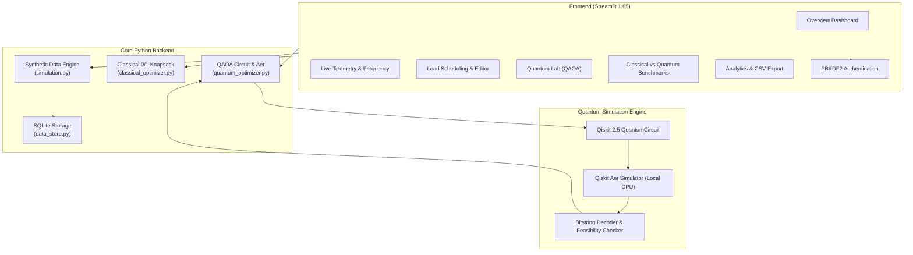

# GridFlex-Q: Real-Time Quantum-Assisted Emergency Power Scheduling & Intelligent Energy Monitoring System

[](https://www.python.org/downloads/)
[](https://streamlit.io/)
[](https://qiskit.org/)
[](https://qiskit.github.io/qiskit-aer/)
[](https://opensource.org/licenses/MIT)
[](https://pytest.org/)

> **SIMULATION & EDUCATIONAL DISCLAIMER**  
> **GridFlex-Q is an educational energy-management prototype.** All telemetry readings (voltage, grid frequency, power factor, and currents) are synthesized by a local physics-grounded engine for algorithm demonstration. **GridFlex-Q is NOT connected to real sensors, electrical hardware, live utility grids, or actual physical switchgear.** Quantum circuits are executed on the local classical **Qiskit Aer simulator**, not physical quantum hardware (QPUs). No quantum advantage or supremacy is claimed.

---

## 📑 Table of Contents
1. [Project Overview & Problem Statement](#1-project-overview--problem-statement)
2. [Key Features](#2-key-features)
3. [System Architecture](#3-system-architecture)
4. [Mathematical Formulation](#4-mathematical-formulation)
   - [Classical 0/1 Knapsack Formulation](#a-classical-01-knapsack-formulation)
   - [QUBO & Cost Hamiltonian Mapping](#b-qubo--cost-hamiltonian-mapping)
   - [QAOA Quantum Circuit Architecture](#c-qaoa-quantum-circuit-architecture)
5. [Canonical Sample Dataset & Manual Verification](#5-canonical-sample-dataset--manual-verification)
6. [Windows Setup & Quickstart (PowerShell)](#6-windows-setup--quickstart-powershell)
7. [Safe Recovery Procedure (auth.py Directory Trap)](#7-safe-recovery-procedure-authpy-directory-trap)
8. [Testing Suite](#8-testing-suite)
9. [2-Minute Hackathon Demonstration Script](#9-2-minute-hackathon-demonstration-script)
10. [Screenshots Checklist](#10-screenshots-checklist)
11. [Limitations & Future Roadmap](#11-limitations--future-roadmap)

---

## 1. Project Overview & Problem Statement

During extreme weather events, grid infrastructure damage, or microgrid islanding, electrical supply capacity can abruptly drop below connected facility demand. When demand exceeds available power, generators undergo rotational frequency decay (governor droop) and transmission lines experience voltage collapse, triggering cascading blackouts.

Traditional emergency protocols often rely on crude, static circuit breaker groups. **GridFlex-Q** demonstrates an intelligent approach:
- Simulates realistic electrical campus demand and supply deficits.
- Dynamically schedules prioritized loads (e.g., life-safety emergency lighting, critical IT routers, water pumps).
- Implements an exact **classical combinatorial optimization baseline**.
- Formulates and executes an authentic **Quantum Approximate Optimization Algorithm (QAOA)** circuit using **Qiskit 2.x** and **Qiskit Aer** to explore quantum combinatorial state exploration.

---

## 2. Key Features

- **Professional Energy-Tech UI/UX:** Dark navy (`#0A0F1D`) & charcoal surfaces with electric cyan (`#00F0FF`) and blue accents, high-contrast typography, and restrained status badges.
- **9 Core Application Sections:**
  1. *Overview Dashboard:* Live supply/demand metrics, status alerts, and active schedule cards.
  2. *Live Simulation:* Voltage sags (230 V nominal), frequency droop (50 Hz nominal), current, and PF telemetry.
  3. *Energy Monitoring:* Individual load power ratings, criticality matrices, and demand distributions.
  4. *Emergency Load Scheduling:* Interactive load editor, capacity sliders, and classical exact knapsack solver.
  5. *Quantum Lab:* Executable parameterized QAOA quantum circuit with configurable depth $p$, shots, penalty $\lambda$, and ASCII circuit diagram viewer.
  6. *Classical vs Quantum Comparison:* Side-by-side benchmarking of objective scores, runtimes, feasibility, and circuit gates.
  7. *Analytics and Reports:* Historical telemetry charts, CSV exports, and downloadable summary reports.
  8. *Authentication & Access:* Salted PBKDF2-HMAC-SHA256 password hashing with SQLite storage and role-based access.
  9. *Project Information & Limitations:* Theoretical derivations, math formulations, and educational boundaries.
- **Physics-Grounded Synthetic Engine:** Realistic load jitter ($\pm 2\%$), voltage sag modeling, and generator frequency droop.
- **Deterministic & Seeded Modes:** Reproducible demonstrations using fixed RNG seeds.

---

## 3. System Architecture



### Module Responsibilities:
- `app.py`: Main Streamlit application entry point and 9-page router.
- `auth.py`: Salted PBKDF2-HMAC-SHA256 credential hashing, user registration, and session gating.
- `simulation.py`: Physics-grounded synthetic telemetry generator and state classifier.
- `classical_optimizer.py`: Exact combinatorial knapsack solver with deterministic tie-breaking.
- `quantum_optimizer.py`: QUBO Hamiltonian construction, QAOA circuit builder, Aer simulation, and bitstring decoder.
- `data_store.py`: Parameterized SQLite persistence for accounts, telemetry history, and benchmark runs.

---

## 4. Mathematical Formulation

### A. Classical 0/1 Knapsack Formulation
For $n$ connected loads, define binary decision variables $x_i \in \{0, 1\}$:
$$x_i = \begin{cases} 1 & \text{if load } i \text{ is scheduled (retained)} \\ 0 & \text{if load } i \text{ is deferred (shed)} \end{cases}$$

$$\text{Maximize } \sum_{i=0}^{n-1} p_i x_i \quad \text{subject to } \sum_{i=0}^{n-1} w_i x_i \le C$$
where $w_i$ is power demand (kW), $p_i$ is priority score ($1 \le p_i \le 10$), and $C$ is available emergency power capacity (kW).

**Deterministic Tie-Breaking:**
1. Highest total priority score $\sum p_i x_i$.
2. Lowest total power consumption $\sum w_i x_i$ (maximizes emergency safety reserve).
3. Lexicographical order of load names.

---

### B. QUBO & Cost Hamiltonian Mapping
To execute on quantum circuits, the constrained maximization problem is transformed into an unconstrained binary quadratic minimization problem (QUBO) via quadratic penalty multiplier $\lambda > 0$:

$$C(x) = -\sum_{i=0}^{n-1} p_i x_i + \lambda \left(\sum_{i=0}^{n-1} w_i x_i - C\right)^2$$

Expanding the penalty:
$$\left(\sum_{i} w_i x_i - C\right)^2 = \sum_{i} (w_i^2 - 2 C w_i) x_i + 2 \sum_{i < j} w_i w_j x_i x_j + C^2$$

Substituting the spin mapping $x_i = \frac{I - Z_i}{2}$ yields the **Cost Hamiltonian $H_C$**:
$$H_C = \sum_{i=0}^{n-1} h_i Z_i + \sum_{0 \le i < j < n} J_{ij} Z_i Z_j + \text{offset} \cdot I$$
where:
$$h_i = -\frac{\alpha_i}{2} - \sum_{j \neq i} \frac{\beta_{ij}}{4}, \quad J_{ij} = \frac{\beta_{ij}}{4} = \frac{\lambda w_i w_j}{2}$$
$$\alpha_i = -p_i + \lambda(w_i^2 - 2 C w_i), \quad \beta_{ij} = 2 \lambda w_i w_j$$

---

### C. QAOA Quantum Circuit Architecture
1. **Initial Superposition:** Apply Hadamard gates across all $n$ qubits:
   $$|+\rangle^{\otimes n} = \frac{1}{\sqrt{2^n}} \sum_{x \in \{0, 1\}^n} |x\rangle$$
2. **Alternating QAOA Layers (Depth $p$):** For layer $l = 1, \dots, p$:
   - **Cost Unitary $U(H_C, \gamma_l)$:**
     $$U(H_C, \gamma_l) = \exp(-i \gamma_l H_C) = \prod_{i} R_z(2 h_i \gamma_l)_i \prod_{i < j} R_{zz}(2 J_{ij} \gamma_l)_{i, j}$$
   - **Mixer Unitary $U(H_M, \beta_l)$:**
     $$U(H_M, \beta_l) = \exp(-i \beta_l \sum_i X_i) = \prod_{i} R_x(2 \beta_l)_i$$
3. **Measurement:** All qubits measured into classical register in computational $Z$ basis.
4. **Decoding & Verification:** Every measured bitstring is converted to load selections and checked against capacity $C$. If no sampled bitstring satisfies capacity, the system transparently reports that no feasible solution was sampled.

---

## 5. Canonical Sample Dataset & Manual Verification

| Load Name | Power ($w_i$, kW) | Priority ($p_i$) | Criticality | Default Optimal Status ($C = 7\text{ kW}$) |
|---|:---:|:---:|:---:|:---:|
| **Emergency Lighting** | 2.0 | 10.0 | Critical | **Scheduled (1)** |
| **Network Equipment** | 3.0 | 8.0 | High | **Scheduled (1)** |
| **Water Pump** | 4.0 | 7.0 | High | Deferred (0) |
| **Classroom AC** | 5.0 | 3.0 | Low | Deferred (0) |
| **Laboratory Equipment** | 2.0 | 6.0 | Medium | **Scheduled (1)** |
| **General Lighting** | 1.0 | 5.0 | Medium | Deferred (0) |

### Verifiable Optimal Solution:
- Total Connected Demand: $2 + 3 + 4 + 5 + 2 + 1 = 17.0\text{ kW}$
- Emergency Supply Capacity: $7.0\text{ kW}$
- **Optimal Load Subset:** `[Emergency Lighting, Network Equipment, Laboratory Equipment]`
- **Optimal Bitstring:** `110010`
- **Total Selected Power:** $2.0 + 3.0 + 2.0 = \mathbf{7.00\text{ kW}}$
- **Unused Capacity Reserve:** $\mathbf{0.00\text{ kW}}$
- **Maximized Objective Score:** $10.0 + 8.0 + 6.0 = \mathbf{24.0}$

Both the classical exact optimizer and the simulated QAOA circuit sample this identical optimal schedule.

---

## 6. Windows Setup & Quickstart (PowerShell)

Follow these exact commands in Windows PowerShell:

### 1. Open Project Directory
```powershell
cd c:\Users\Admin\Downloads\GridFlex-Q
```

### 2. Create & Activate Python Virtual Environment
```powershell
python -m venv .venv
.\.venv\Scripts\Activate.ps1
```

### 3. Upgrade Pip & Install Pinned Dependencies
```powershell
python -m pip install --upgrade pip
pip install -r requirements.txt
```

### 4. Run Unit Tests (19/19 Tests)
```powershell
python -m pytest -v
```

### 5. Launch the Streamlit Web Application
```powershell
python -m streamlit run app.py
```

Open your browser to: **`http://localhost:8501`**

To stop the application at any time, press `Ctrl + C` in PowerShell.

---

## 7. Safe Recovery Procedure (auth.py Directory Trap)

If a previous broken installation created a directory named `auth.py` instead of a Python file, Python will fail to import authentication logic.

### Safe PowerShell Recovery Steps:
```powershell
# 1. Verify if auth.py is accidentally a directory
Get-Item auth.py

# 2. If it is a directory, remove it safely:
Remove-Item -Recurse -Force auth.py

# 3. Verify that auth.py is now a genuine Python file (.py)
Test-Path auth.py
```

---

## 8. Testing Suite

The project includes an automated test suite in `tests/` covering 19 test cases:

```powershell
python -m pytest -v
```

### Verified Test Cases:
- `test_known_benchmark_7kw`: Exact mathematical verification of 7 kW optimal load subset (Score 24.0).
- `test_capacity_strictly_enforced`: Verification across multiple arbitrary capacities.
- `test_zero_capacity` & `test_negative_capacity`: Safe deferral of all loads without crashing.
- `test_empty_loads_list`: Safe handling of empty datasets.
- `test_all_loads_exceed_capacity`: Verification when every single load exceeds capacity.
- `test_deterministic_tie_breaking`: Verifies tie-breaking by lowest power reserve.
- `test_invalid_input_validation`: Negative power and out-of-range priority validation.
- `test_disabled_loads_filtering`: Selective toggling of load subsystems.
- `test_qubo_hamiltonian_formulation`: QUBO coefficient mapping and array symmetry.
- `test_qaoa_circuit_execution_on_aer`: Real execution on Qiskit Aer simulator.
- `test_objective_score_agreement_classical_vs_quantum`: Verifies classical and quantum scoring parity.
- `test_quantum_zero_capacity_behavior`: Edge case handling in quantum circuit.
- `test_quantum_impossible_capacity_infeasible_reporting`: Verifies quantum does not fabricate solutions when none are feasible.
- `test_default_sample_loads_structure`: Canonical dataset integrity.
- `test_deterministic_simulation_seed`: Telemetry reproducibility across fixed seeds.
- `test_grid_operating_state_classification`: Normal, Warning, and Emergency state transitions.
- `test_telemetry_physical_bounds`: Physical realism checks for voltage, frequency, and power factor.
- `test_load_manipulation`: Dynamic additions and deletions.

---

## 9. 2-Minute Hackathon Demonstration Script

### [0:00 – 0:20] 1. The Emergency Problem
> *"Good morning, judges. Imagine an extreme storm knocks out utility power to a university medical campus. Total connected demand is 17 kW, but emergency backup generators can only deliver 7 kW. Without intelligent intervention, unmanaged load will trigger severe voltage sag and frequency collapse, shutting down the entire facility. This is GridFlex-Q."*

### [0:20 – 0:40] 2. Synthetic Telemetry & Detection
> *(Navigate to **1. Overview Dashboard**)*  
> *"On our dashboard, you immediately see the red alert: Emergency Shortage. Notice our explicit badge: this telemetry is synthetic and physics-grounded. Under **2. Live Simulation**, you can observe simulated voltage sagging to 220 V and grid frequency drooping to 49.8 Hz due to generator stress."*

### [0:40 – 1:00] 3. Dynamic Load Management
> *(Navigate to **4. Emergency Load Scheduling**)*  
> *"Here in Emergency Scheduling, we monitor 6 facility loads. Our classical exact optimizer instantly evaluates all combinations and selects Emergency Lighting, Network Equipment, and Laboratory Equipment. Total power: exactly 7.00 kW, objective priority score: 24.0. AC and general lighting are deferred."*

### [1:00 – 1:30] 4. Executing the QAOA Quantum Circuit
> *(Navigate to **5. Quantum Lab**)*  
> *"Now we turn to quantum optimization. We formulate the problem into a QUBO Cost Hamiltonian with quadratic penalty $\lambda=4.0$. Clicking **Run QAOA Circuit**, we compile a parameterized Qiskit 2.x circuit with $R_z$, $R_{zz}$, and $R_x$ mixer gates, executing 1,024 shots on the local Qiskit Aer simulator. As you can see in the histogram, quantum state collapse discovers bitstring `110010` as our top feasible solution."*

### [1:30 – 1:50] 5. Classical vs Quantum Benchmarking
> *(Navigate to **6. Classical vs Quantum Comparison**)*  
> *"In our comparison matrix, we benchmark both approaches transparently. On this 6-qubit instance, the classical optimizer is instantaneous (under 2 ms). QAOA explores the combinatorial Hilbert space, achieving the same 24.0 score with a 42% feasible sample rate. We emphasize that simulator runtime includes matrix simulation overhead, and small problems do not exhibit quantum supremacy."*

### [1:50 – 2:00] 6. Summary & Future Scope
> *(Navigate to **7. Analytics and Reports**)*  
> *"Finally, operators can export audit reports and CSV telemetry. GridFlex-Q proves how quantum formulations can be modeled for microgrid resilience. Thank you!"*

---

## 10. Screenshots Checklist

When creating documentation or slide decks, capture:
1. **Overview Dashboard:** Prominent red "Emergency Shortage" alert, 4 metric cards, and live telemetry plot.
2. **Live Simulation Page:** Dual charts showing voltage sag (230V to 220V) and frequency droop (50Hz to 49.7Hz).
3. **Emergency Scheduling Page:** Load inventory table, capacity slider at 7.0 kW, and scheduled vs deferred lists.
4. **Quantum Lab Page:** QAOA parameter sliders, Aer simulator runtime card, and top 20 measured bitstring histogram.
5. **Circuit Diagram View:** Text/ASCII Qiskit circuit representation showing $R_z$, $R_{zz}$, and $R_x$ gates.
6. **Comparison Matrix:** Benchmark table comparing classical exact vs QAOA Aer metrics side-by-side.
7. **Authentication View:** PBKDF2 operator login form and credential security notice.

---

## 11. Limitations & Future Roadmap

### Current Prototype Boundaries:
1. **Simulated Sensor Feed:** Readings are synthetic generated values, not Modbus/BACnet/SCADA inputs.
2. **Local Simulation:** Executed on local classical CPU Qiskit Aer simulator rather than IBM Quantum QPUs.
3. **Linear Approximations:** Considers active real power (kW) and constant power factor rather than non-linear AC optimal power flow (AC-OPF).
4. **No Grid Actuation:** Software does not interface with live circuit breakers or switchgear.

### Future Roadmap:
- **Phase 2:** Connect to real OpenADR or MQTT telemetry brokers for live campus sensor ingestion.
- **Phase 3:** Submit QAOA jobs to IBM Quantum physical quantum processors via `qiskit-ibm-runtime`.
- **Phase 4:** Expand QUBO formulation to multi-period time-horizon battery energy storage scheduling (BESS) and solar forecasting.
